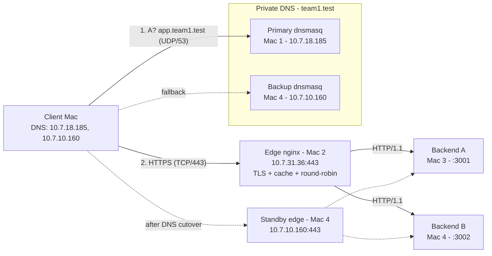

# CN-Project-VSharks - Private Network Service Platform

> **The application stays simple; the network is the project.**
> A small private service environment built from four MacBooks on one LAN: private DNS, an HTTPS reverse proxy with load
> balancing, two REST backends - hardened in Phase 2 with backup DNS, TTL control, firewall isolation, failover and DNS-based
> edge migration. No cloud, no pre-built servers.

**Team VSharks** - Computer Networks course project, Newton School of Technology, Rishihood University.

| Mac | Owner | IP (Phase 2) | Role |
|---|---|---|---|
| Mac 1 | Aarya | `10.7.18.185` | **Primary DNS** - dnsmasq |
| Mac 2 | Suhaani | `10.7.31.36` | **Edge** - nginx reverse proxy, TLS termination, round-robin load balancer, test client |
| Mac 3 | Krishna | `10.7.28.30` | **Backend A** - Python REST on `:3001`, pf-isolated |
| Mac 4 | Vriha | `10.7.10.160` | **Backend B** `:3002` (pf-isolated) + **backup DNS** + **standby edge** |

## Architecture



Request path: **DNS** (`app.team1.test` -> edge IP) -> **TCP** handshake (443) -> **TLS** handshake -> **HTTPS** request ->
nginx **round-robin** -> backend A or B -> response with `X-Backend: A|B`. 
## Repository layout

```
.
├── README.md                          this file
├── Architecture/
│   └── Architecture_Doc.pdf           topology, IP/service table, request flow (Phase 1 + Phase 2)
├── Backend/
│   ├── backend-a/app.py               REST backend A  (:3001)
│   └── backend-b/app.py               REST backend B  (:3002)
├── Configuration/
│   ├── phase1/                        dnsmasq.conf, nginx.conf  (Phase 1 baseline)
│   ├── phase2/
│   │   ├── dnsmasq-primary.conf       primary DNS (+ short-TTL test record)
│   │   ├── dnsmasq-backup.conf        backup DNS
│   │   ├── nginx-edge.conf            edge: TLS, cache, LB, passive health checks
│   │   ├── nginx-standby.conf         standby edge for the DNS cutover
│   │   ├── pf-backend-a.rules         firewall isolation, Backend A
│   │   └── pf-backend-b.rules         firewall isolation, Backend B
│   ├── TLS-Setup.md                   certificate, CA trust, verification
│   ├── Backend-Launch.md              start / test the backends
│   └── Phase2-Runbook.md              commands to repeat every extension + rollback
├── Evidence_P1/  Evidence_P2/         screenshots (see index below)      [kept in the main repo]
├── Reports/
│   ├── Phase2_Final_Report.pdf        10-page IEEE-format report
│   └── Evaluation_Prep.md             demo script, Extension F playbook, viva Q&A
└── Presentation/
    └── VSharks_Final_Presentation.pptx
```

## Quick start (reproduce the system)

1. **Network** - put all Macs on the same Wi-Fi/LAN; note each IP (`ipconfig getifaddr en0`) and `ping` every pair.
2. **DNS** - install dnsmasq (`brew install dnsmasq`); use `Configuration/phase2/dnsmasq-primary.conf` on Mac 1 and
   `dnsmasq-backup.conf` on Mac 4; `sudo brew services start dnsmasq`. On each client:
   `sudo networksetup -setdnsservers Wi-Fi 10.7.18.185 10.7.10.160`.
3. **Backends** - `python3 Backend/backend-a/app.py` (Mac 3) and `python3 Backend/backend-b/app.py` (Mac 4) - see [`Backend-Launch.md`](Configuration/Backend-Launch.md).
4. **TLS** - create the local CA + certificate and trust the CA on clients - see [`TLS-Setup.md`](Configuration/TLS-Setup.md). *The private key is never committed.*
5. **Edge** - `brew install nginx`; use `Configuration/phase2/nginx-edge.conf`; `nginx -t && sudo nginx -s reload`.
6. **Isolation** - load `pf-backend-*.rules` into anchor `com.apple/team1` - see [`Phase2-Runbook.md`](Configuration/Phase2-Runbook.md).

Smoke test (from a client, no `-k`):

```bash
dig +short app.team1.test                                   # 10.7.31.36
curl -i https://app.team1.test/api/status                   # 200 OK, X-Backend: A or B
for i in {1..6}; do curl -s -i https://app.team1.test/api/status | grep X-Backend; done   # A/B alternate
```

## Status against the project brief

| Phase | Item | Status | Evidence |
|---|---|---|---|
| 1 | A - Private LAN | done | `Evidence_P1/01-04, 12-18` |
| 1 | B - Private DNS (dnsmasq) | done | `Evidence_P1/05-11, 43-45` |
| 1 | C - Two REST backends (`X-Backend`) | done | `Evidence_P1/19-20` |
| 1 | D - Reverse proxy + round-robin LB | done | `Evidence_P1/28-29` |
| 1 | E - HTTPS / TLS (trusted cert, no `-k`) | done | `Evidence_P1/22-27` |
| 1 | F - HTTP caching (`Cache-Control`, MISS/HIT/EXPIRED) | done | `Evidence_P1/37` |
| 1 | G - Protocol flow in Wireshark (DNS, TCP, TLS) | done | `Evidence_P1/30-36` |
| 1 | Failure demos (wrong DNS, wrong port, backend stopped) | done | `Evidence_P1/21, 38-42` |
| 2 | **A** - Backup DNS | done | `Evidence_P2/A_Backup_DNS` |
| 2 | **B** - DNS TTL and record change | done | `Evidence_P2/B_DNS_TTL` |
| 2 | **C** - Service isolation (pf) | done | `Evidence_P2/C_Service_Isolation` |
| 2 | **D** - HA failover | done | `Evidence_P2/D_High_Availability` |
| 2 | **E** - Edge migration (DNS cutover) | done | `Evidence_P2/E_Edge_Migration` |
| 2 | **F** - Faculty-injected fault | at evaluation | `Reports/Evaluation_Prep.md` |

## Evidence index

| Looking for | Where |
|---|---|
| IP / ping inventory | `Evidence_P2/00_Network_Setup` |
| `dig` answers, `aa` flag, resolver config | `Evidence_P2/A_Backup_DNS/P2_05-P2_08, P2_11-P2_12` |
| Primary stopped, backup answers | `Evidence_P2/A_Backup_DNS/P2_13-P2_15` |
| TTL 30 record, cache countdown, record change | `Evidence_P2/B_DNS_TTL/P2_16, P2_17, P2_34_37, P2_35` |
| pf rules, edge allowed, client blocked | `Evidence_P2/C_Service_Isolation/P2_18-P2_25` |
| A/B alternation, Backend A stopped, restored | `Evidence_P2/D_High_Availability/P2_26-P2_28` |
| Standby edge, DNS cutover, HTTPS after migration | `Evidence_P2/E_Edge_Migration/P2_29-P2_33` |
| Wireshark DNS / TCP / TLS | `Evidence_P1/30-36` |
| Cache MISS / HIT / EXPIRED | `Evidence_P1/37` |

## Security notes

- The TLS **private key and CA key are not in this repository**; certificates live only under `/opt/homebrew/etc/nginx/certs/` on the edge Macs.
- Backends listen on all interfaces so the edge can reach them, but pf allows only the edge IP(s) to ports 3001/3002 (Extension C).
- The pf rules were demonstrated and then rolled back - procedure in `Configuration/Phase2-Runbook.md`.

## Known limitations

- The edge nginx (and the shared Wi-Fi) is still a single point of failure; DNS cutover is manual. Production answer: VRRP/keepalived or health-checked DNS failover.
- DHCP addresses changed between phases; addresses in the configs are the Phase 2 ones.
- Health checking is passive (nginx open source); active checks need nginx Plus or a sidecar script.
